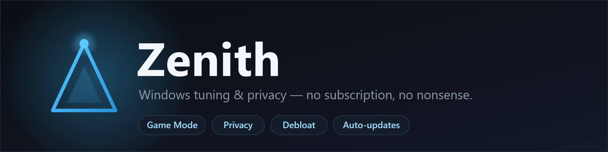
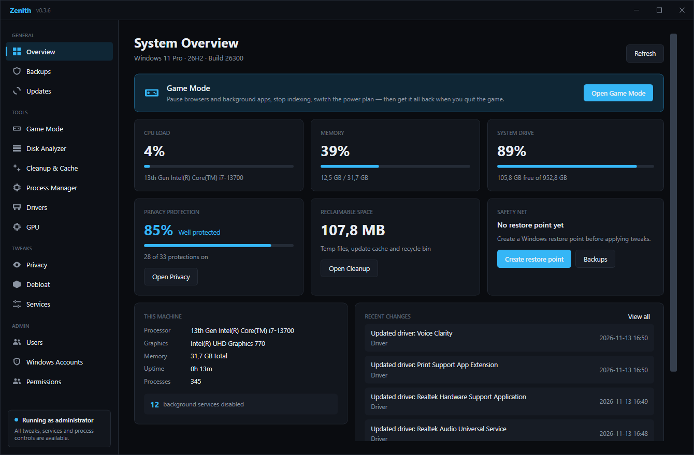
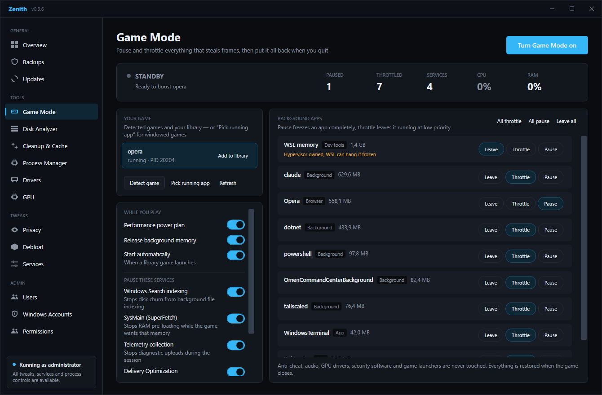
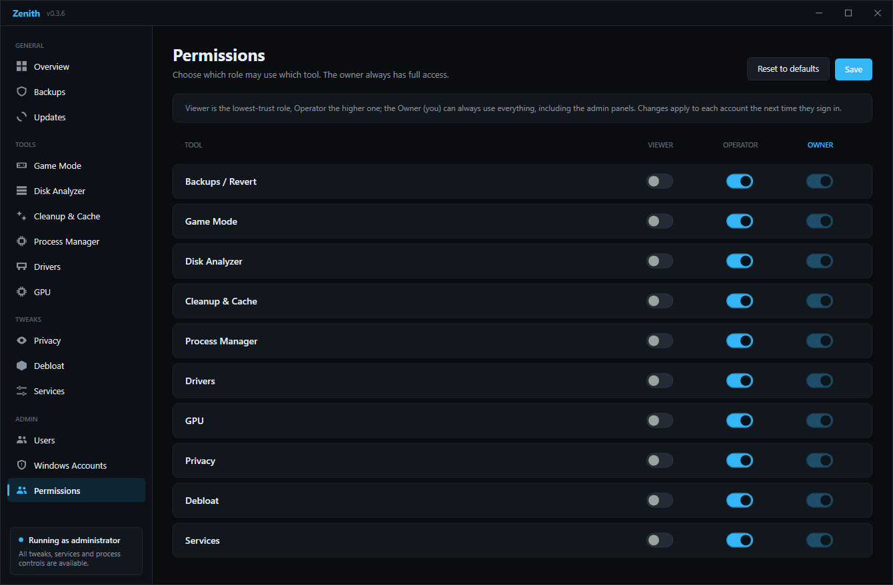

 

**Ein schnelles, aufgeräumtes Windows‑Tuning‑ & Privacy‑Tool — ohne Abo, ohne Werbung, ohne Cloud.**

### [⬇️  Download — Zenith für Windows](https://github.com/Liamro11/zenith-releases/releases/latest/download/Zenith-dist.exe)

Eine einzige `.exe` · kein Installer · keine .NET‑Runtime nötig · updatet sich selbst

---

## Was ist Zenith?

Zenith bündelt die Dinge, für die man sonst fünf verschiedene Tools (oder ein Abo) braucht, in **einer sauberen App**: mehr FPS beim Zocken, weniger Telemetrie, aufgeräumte Platte, entschlacktes Windows — alles **umkehrbar** und mit einem **Sicherheitsnetz**.

---

## Features

| Modul | Was es macht |
|---|---|
| 🎮 **Game Mode** | Pausiert/drosselt Hintergrund‑Apps & ‑Dienste, schaltet den Energieplan um — und stellt beim Beenden alles zurück. Anti‑Cheat, Audio, GPU‑Treiber & Launcher werden **nie** angefasst. |
| 🛡️ **Privacy** | Schaltet Telemetrie, Werbe‑ID, Aktivitätsverlauf, Game‑Bar‑Overlay u. v. m. ab. |
| 🧹 **Cleanup & Cache** | Temp‑Dateien, Update‑Cache und Papierkorb — zeigt vorher, was freigeräumt wird. |
| 💽 **Disk Analyzer** | Findet die größten Platzfresser auf der Platte. |
| ⚙️ **Process Manager** | Prozesse ansehen, Priorität/Affinität setzen, beenden. |
| 🧩 **Drivers** | Treiber‑Inventar + Suche nach Updates — rein über Windows‑Bordmittel. |
| 📦 **Debloat** | Entfernt vorinstallierten Windows‑Ballast. |
| 🔧 **Services** | Windows‑Dienste gezielt steuern. |
| ⏪ **Backups / Revert** | Jede Änderung landet im Journal und lässt sich zurücknehmen. |

---

## Sicherheit zuerst

- **Alles umkehrbar.** Jede Registry‑/Dienst‑Änderung wird mit dem vorherigen Wert ins **Journal** geschrieben — ein Klick stellt sie zurück.
- **Harte Schutzliste.** Im Game Mode sind Anti‑Cheat, Audio‑/GPU‑Stack, Security‑Software, Windows‑Shell und Game‑Launcher gesperrt und werden nie gedrosselt.
- **Restore‑Point.** Lege vor großen Tweaks einen Windows‑Wiederherstellungspunkt an — direkt aus der App.

---

## Rollen & Rechte

Mehrere Leute am selben PC? Zenith kennt **Owner**, **Operator** und **Viewer**. Der Owner legt in einer übersichtlichen Matrix fest, **welche Rolle welches Tool** benutzen darf.

---

## Installation

1. **[Zenith herunterladen](https://github.com/Liamro11/zenith-releases/releases/latest/download/Zenith-dist.exe)**
2. Doppelklick. Kommt **SmartScreen** („Der Computer wurde geschützt"), dann: **Weitere Informationen → Trotzdem ausführen** (die `.exe` ist nur nicht signiert).
3. **UAC** mit „Ja" bestätigen (Zenith braucht Adminrechte, um tweaken zu können).
4. Fertig — kein Installer, keine .NET‑Runtime nötig.

> 💡 **Updates:** In der App unter **Updates → „Check for updates"**. Zenith lädt die neue Version, prüft die Prüfsumme und startet sich neu. Kein manuelles Nachladen.

---

## FAQ

**Ist das wirklich kostenlos?** Ja. Keine Pro‑Version, kein Abo, keine In‑App‑Käufe.

**Warnt mein Virenscanner?** Möglich — Tuning‑Tools ändern Registry/Dienste und die `.exe` ist nicht teuer signiert. Das ist ein Fehlalarm; ggf. eine Ausnahme setzen.

**Sammelt Zenith Daten?** Nein. Keine Telemetrie, keine Cloud, nichts verlässt deinen PC.

**Läuft auf Windows 10?** Ja, Windows 10 & 11 (64‑bit).

---

Dieses Repo enthält nur die veröffentlichten Binärdateien für den Auto‑Updater. Der Quellcode ist privat.

